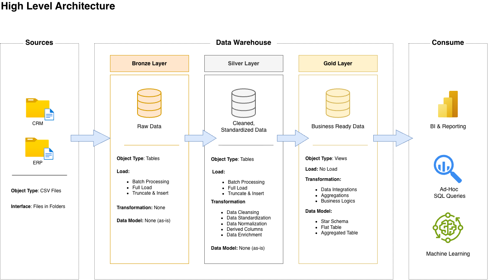
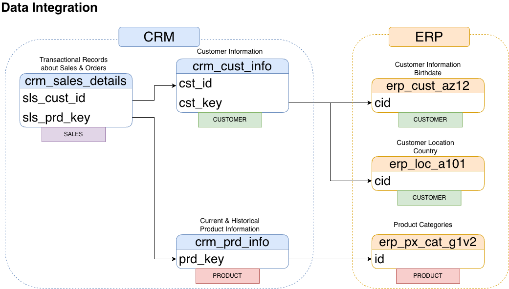
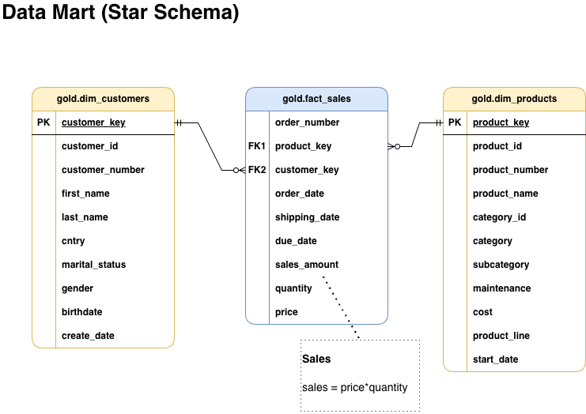

# Data Warehouse and Analytics Project

### Building a Modern Data Warehouse with PostgreSQL

**An end-to-end SQL data warehouse integrating CRM and ERP data into a business-ready analytical model.**

This project implements a three-layer **Medallion Architecture** using **PostgreSQL, SQL, and PL/pgSQL**. Six CRM and ERP CSV datasets are loaded into the **Bronze** layer, cleansed and standardized in **Silver**, and integrated into a **Gold** star schema. The repository includes database definitions, repeatable ETL procedures, data quality checks, architecture diagrams, a Gold-layer data dictionary, and six SQL analytical reporting views covering customer behavior, product performance, and sales trends.

The project follows the architecture and development framework in Mr.Baraa Khatib Salkini's SQL course. While the reference implementation uses Microsoft SQL Server, this implementation uses PostgreSQL-specific SQL and PL/pgSQL for data ingestion, procedures, transformations, exception handling, and execution monitoring.

## Table of Contents

1. [Project at a Glance](#project-at-a-glance)
2. [Business Objective and Requirements](#business-objective-and-requirements)
3. [Technology Stack](#technology-stack)
4. [Data Architecture](#data-architecture)
5. [Source Datasets and Data Flow](#source-datasets-and-data-flow)
6. [ETL Pipeline and Data Transformations](#etl-pipeline-and-data-transformations)
7. [CRM and ERP Data Integration](#crm-and-erp-data-integration)
8. [Gold Layer: Star Schema](#gold-layer-star-schema)
9. [Gold Layer: SQL Analytics and Reporting](#gold-layer-sql-analytics-and-reporting)
10. [Data Quality and Validation](#data-quality-and-validation)
11. [Repository Structure](#repository-structure)
12. [Getting Started](#getting-started)
13. [Development Approach and Conventions](#development-approach-and-conventions)
14. [Scope, Limitations, and Next Steps](#scope-limitations-and-next-steps)
15. [Acknowledgments](#acknowledgments)
16. [License](#license)

---

## Project at a Glance

| Area | Implementation |
|---|---|
| **Database** | PostgreSQL |
| **Languages** | SQL, PL/pgSQL |
| **Development environment** | DBeaver |
| **Architecture** | Medallion: Bronze → Silver → Gold |
| **Sources** | Six CSV datasets from CRM and ERP |
| **Ingestion** | Server-side PostgreSQL `COPY` |
| **ETL** | Full-refresh procedures with progress messages, error handling, and timing |
| **Transformations** | Deduplication, standardization, date conversion, enrichment, and derived fields |
| **Modeling** | Star schema: two dimension views and one sales fact view |
| **SQL analytics** | Six Gold-layer report views for customer behavior, product performance, and sales trends |
| **Validation** | Silver, Gold integration, and analytical report validation queries |
| **Documentation** | Gold data dictionary and editable draw.io architecture diagrams |

## Business Objective and Requirements

Customer, product, and sales data are distributed across separate CRM and ERP extracts. The datasets contain different identifier formats, descriptive values, dates, and levels of detail. The objective is to consolidate them into a consistent data warehouse that supports reliable **SQL analysis and reporting**.

The implementation addresses four requirements:

1. **Reliable ingestion:** retain raw source records in a traceable layer to support debugging and repeatable loading.
2. **Data preparation:** handle duplicate records, inconsistent values, missing information, invalid dates, and other data-quality issues.
3. **Source integration:** standardize identifiers and connect related CRM and ERP customer and product data.
4. **Analytical modeling:** publish business-friendly dimensions and sales measures through a star schema.
5. **SQL reporting:** develop reusable customer, product, and sales analytics views for business KPI reporting.

**Current deliverable:** the SQL data warehouse, six analytical reporting views, validation queries, and supporting documentation. The SQL reports provide descriptive KPIs, segmentation, and sales trend calculations. Interactive dashboards and a separate narrative of business findings remain future extensions.

## Technology Stack

| Technology | Role in the project |
|---|---|
| **PostgreSQL** | Database and three-layer warehouse |
| **SQL** | DDL, data transformations, joins, views, and validation queries |
| **PL/pgSQL** | Stored procedures, notices, exception handling, and ETL monitoring |
| **DBeaver** | Writing, executing, and inspecting PostgreSQL queries |
| **CSV** | Input data extracts from CRM and ERP |
| **GitHub** | Source control, SQL scripts, and documentation |
| **draw.io / diagrams.net** | Data architecture, data flow, source integration, and star-schema modeling |
| **Notion** | Organizing project tasks and development stages |

### PostgreSQL Implementation Details

The reference project was developed for SQL Server. The corresponding PostgreSQL implementation uses:

- `CREATE OR REPLACE PROCEDURE` and `CALL` for reusable ETL pipelines.
- `COPY ... WITH (FORMAT CSV, HEADER TRUE)` for loading CSV files into Bronze tables.
- `RAISE NOTICE` for table-level progress and execution feedback.
- `EXCEPTION WHEN OTHERS`, `SQLERRM`, and `SQLSTATE` to report and propagate errors.
- `clock_timestamp()` and `EXTRACT(EPOCH FROM ...)` to measure per-table and batch duration.
- `ROW_NUMBER()` for customer deduplication and view-level surrogate keys.
- `LEAD()` and date arithmetic to derive product effective-date ranges.
- `TO_DATE()`, `CASE`, `COALESCE()`, `TRIM()`, `UPPER()`, `SUBSTRING()`, and `REPLACE()` for cleaning and standardization.
- PostgreSQL **views** to expose the Gold-layer dimensions and fact without separately loading physical Gold tables.
- `DATE_TRUNC()`, `LAG()`, window aggregates, `DENSE_RANK()`, and window frames for trend analysis, moving averages, and revenue-based segmentation.

These choices implement the course's warehouse design in PostgreSQL rather than reproducing SQL Server/T-SQL code verbatim.

---

## Data Architecture

The warehouse uses **Medallion Architecture**, separating data ingestion, preparation, and analytical consumption by responsibility.

### High-Level Architecture



| Layer | Object type | Loading | Responsibility |
|---|---|---|---|
| **Bronze** | PostgreSQL tables | Full refresh from CSV | Retain raw source records for traceability and debugging |
| **Silver** | PostgreSQL tables | Full refresh from Bronze | Clean, standardize, normalize, derive, and enrich data |
| **Gold** | PostgreSQL views | No separate load | Integrate customer, product, and sales data for analytical SQL |

#### Bronze — Raw Data

The Bronze layer preserves the six source datasets in their incoming structures. The stored procedure truncates and reloads each source table, rather than appending duplicate copies across runs. Business-level transformations are deferred to Silver.

#### Silver — Cleaned and Standardized Data

The Silver layer produces consistent, integration-ready tables. Examples include deduplicating customers, standardizing text values, converting encoded dates into native PostgreSQL dates, correcting selected numeric fields, deriving category identifiers, and computing product effective-date ranges. Each table also has a `dwh_create_date` column with a default warehouse timestamp.

#### Gold — Business-Ready Data

The Gold layer presents two dimensions and one fact view. It combines Silver records through joins, applies business-facing column aliases, and exposes the data through a **star schema**. As ordinary PostgreSQL views, Gold objects reflect the underlying Silver data when queried.

---

## Source Datasets and Data Flow

The project consumes six source CSV files, grouped into CRM and ERP extracts.

| System | Source file | Bronze destination | Content |
|---|---|---|---|
| CRM | `cust_info.csv` | `bronze.crm_cust_info` | Customer IDs, names, gender, marital status, creation dates |
| CRM | `prd_info.csv` | `bronze.crm_prd_info` | Product IDs, keys, names, costs, product lines, effective dates |
| CRM | `sales_details.csv` | `bronze.crm_sales_details` | Orders, customer/product references, dates, quantity, sales, price |
| ERP | `CUST_AZ12.csv` | `bronze.erp_cust_az12` | Customer birthdates and gender |
| ERP | `LOC_A101.csv` | `bronze.erp_loc_a101` | Customer country/location |
| ERP | `PX_CAT_G1V2.csv` | `bronze.erp_px_cat_g1v2` | Product category, subcategory, and maintenance data |

All six CRM and ERP CSV files are included in the `datasets/` directory.

No separate dataset download is required.

After cloning the repository, configure the file paths in `scripts/bronze/proc_load_bronze.sql` to point to the corresponding local CSV files. PostgreSQL's server-side `COPY` command requires the database server to have permission to read these files.
The datasets and base architecture come from the [reference course repository](https://github.com/DataWithBaraa/sql-data-warehouse-project).

### Dataset Movement Across Layers


Each source has a corresponding Bronze and Silver table. In the Gold layer:

- CRM customer records are enriched using ERP demographics and locations.
- CRM products are enriched using ERP product classifications.
- CRM sales are associated with the customer and product dimensions.

---

## ETL Pipeline and Data Transformations

The pipeline is implemented in **SQL and PL/pgSQL**, with a reusable stored procedure for each physical loading layer.

### 1. Bronze Loading: CSV → Raw Tables

**Procedure:** `bronze.load_bronze()`

The Bronze procedure:

1. Truncates each Bronze table before reloading source data.
2. Imports each CSV with PostgreSQL server-side `COPY`.
3. Displays progress messages using `RAISE NOTICE`.
4. Measures per-table and total batch execution time.
5. Reports `SQLERRM` and `SQLSTATE` if a load fails, then re-raises the error.

```sql
CALL bronze.load_bronze();
```

Example of the PostgreSQL loading pattern:

```sql
TRUNCATE TABLE bronze.crm_cust_info;

COPY bronze.crm_cust_info
FROM '/absolute/path/to/datasets/source_crm/cust_info.csv'
WITH (
    FORMAT CSV,
    HEADER TRUE,
    DELIMITER ','
);
```

**Loading behavior:** this is a full refresh of the source tables—not incremental ingestion.

### 2. Silver Loading: Raw Tables → Standardized Tables

**Procedure:** `silver.load_silver()`

Silver transformations are executed with `INSERT INTO ... SELECT` statements. Each destination table is truncated before inserting transformed records. The procedure also records per-table and overall load duration and re-raises any processing errors.

```sql
CALL silver.load_silver();
```

#### Customer Records

- Filter records without customer IDs.
- Use `ROW_NUMBER() OVER (PARTITION BY cst_id ORDER BY cst_create_date DESC NULLS LAST)` to retain one record per customer.
- Trim leading and trailing spaces from names.
- Expand and normalize source codes for gender and marital status.

#### Product Records

- Derive `cat_id` from the category-bearing portion of the source product key.
- Derive the standardized product key used for sales matching.
- Replace missing product costs with zero during transformation.
- Normalize product-line codes into business-friendly labels.
- Use `LEAD(prd_start_dt)` to derive the previous version's end date based on the next product version's start date.

#### Sales Records

- Convert `YYYYMMDD` integer-encoded dates to PostgreSQL `DATE` using `TO_DATE()`.
- Set nonpositive or non-eight-digit source date values to `NULL` before conversion.
- Apply transformation rules to sales amounts and unit prices using quantities and other available fields.
- Retain transactional customer and product references for subsequent Gold-layer joins.

#### ERP Customer and Reference Records

- Standardize customer IDs by removing known prefixes or separators.
- Replace future customer birthdates with `NULL`.
- Normalize gender codes and country labels.
- Carry product category, subcategory, and maintenance attributes into the integration-ready Silver layer.

### Processing Monitoring and Error Handling

The Bronze and Silver procedures implement operational feedback using:

```sql
start_time := clock_timestamp();

-- Execute the table load here

end_time := clock_timestamp();
RAISE NOTICE 'Load duration: % seconds',
    EXTRACT(EPOCH FROM (end_time - start_time));
```

Each procedure also captures an overall batch start/end time and handles exceptions using PL/pgSQL's `EXCEPTION` block. The exception is re-raised so callers can distinguish a failed load from a successful one.

**Design trade-off:** full refreshes are straightforward to rerun for this learning project, but do not implement incremental updates, scheduled orchestration, or a persistent ETL audit history.

---

## CRM and ERP Data Integration

Before constructing the Gold views, the datasets were explored to identify the business entities and columns used to connect the source systems. These relationships informed the Silver transformations and Gold joins.



| Relationship | Matching logic |
|---|---|
| Sales → CRM customers | `sls_cust_id` matches `cst_id` |
| CRM customers → ERP demographics | CRM `cst_key` matches standardized ERP `cid` |
| CRM customers → ERP locations | CRM `cst_key` matches standardized location `cid` |
| Sales → CRM products | `sls_prd_key` matches standardized `prd_key` |
| CRM products → ERP categories | Derived `cat_id` matches ERP category `id` |

**Customer enrichment:** CRM provides customer identifiers and names; ERP contributes birthdate, gender, and country. The Gold customer dimension prefers known CRM gender and falls back to ERP gender when the CRM value is unavailable.

**Product enrichment:** CRM provides product information and version history, while ERP contributes category, subcategory, and maintenance attributes.

Identifier standardization is essential here because keys are not consistently formatted across the raw extracts. Unmatched source records are investigated through quality checks rather than silently treated as confirmed matches.

---

## Gold Layer: Star Schema

The Gold layer uses a dimensional **star schema** with two descriptive dimension views and a central sales fact view.



| View | Type | Purpose | Source dependencies |
|---|---|---|---|
| `gold.dim_customers` | Dimension | Customer profiles, demographics, and country | Silver CRM customers, ERP demographics, and ERP locations |
| `gold.dim_products` | Dimension | Active product details, category, costs, and maintenance | Silver CRM products and ERP categories |
| `gold.fact_sales` | Fact | Sales line measures linked to customer and product dimensions | Silver CRM sales and both Gold dimensions |

### `gold.dim_customers`

Includes `customer_key`, `customer_id`, `customer_number`, name fields, country, marital status, gender, birthdate, and customer creation date. The dimension combines CRM information with ERP demographic and location data through `LEFT JOIN` operations.

### `gold.dim_products`

Includes `product_key`, product identifiers, product name, category information, maintenance information, cost, product line, and effective start date. The view filters `prd_end_dt IS NULL` to select the current product version according to the Silver validity logic.

### `gold.fact_sales`

Contains one row per source sales line, subject to the cardinality of the dimension joins. Fields include order number, customer and product keys, order/shipping/due dates, sales amount, quantity, and unit price.

The fact view uses logical relationships:

| Fact key | Dimension key |
|---|---|
| `gold.fact_sales.customer_key` | `gold.dim_customers.customer_key` |
| `gold.fact_sales.product_key` | `gold.dim_products.product_key` |

### Data Model Considerations

- `ROW_NUMBER()` generates `customer_key` and `product_key` dynamically. The keys are **not persisted**, so they may change as underlying data changes.
- The Gold objects are **views**, not physical dimension/fact tables; primary and foreign keys in the model are logical, not database-enforced constraints.
- The use of `LEFT JOIN` preserves unmatched sales records, which may produce `NULL` dimension keys.
- Duplicate business identifiers in a dimension could multiply fact rows. Key uniqueness and row-count checks are therefore important.
- Filtering current products may leave some historical sales without a current product match.

For field-by-field definitions, see the [Gold Layer Data Dictionary](docs/data_catalog.md).

### Example Analytical Query

```sql
SELECT
    p.category,
    SUM(f.sales_amount) AS total_sales,
    SUM(f.quantity) AS units_sold
FROM gold.fact_sales AS f
LEFT JOIN gold.dim_products AS p
    ON p.product_key = f.product_key
GROUP BY p.category
ORDER BY total_sales DESC;
```

This illustrates the intended use of the Gold layer; it is **not** a claim of completed business findings.

---

## Gold Layer: SQL Analytics and Reporting

Building on the Gold star schema, the project includes **six SQL reporting views** that summarize customer behavior, product performance, and historical sales. These views are defined in [`scripts/gold/`](scripts/gold/) alongside the underlying dimension and fact views. They calculate results from the warehouse when queried rather than storing separate reporting tables.

| View | Report granularity | Analytical purpose |
|---|---|---|
| [`gold.report_customers`](scripts/gold/report_customers.sql) | One row per customer | Purchasing history, customer value, recency, and customer segmentation |
| [`gold.report_products`](scripts/gold/report_products.sql) | One row per product | Product revenue, customer reach, selling history, and revenue-based performance segments |
| [`gold.report_sales_monthly`](scripts/gold/report_sales_monthly.sql) | One row per year-month | Monthly performance, MoM/YoY growth, cumulative revenue, and moving average |
| [`gold.report_sales_seasonality`](scripts/gold/report_sales_seasonality.sql) | One row per calendar month | Average, minimum, and maximum monthly performance across observed years |
| [`gold.report_sales_geography`](scripts/gold/report_sales_geography.sql) | One row per customer country | Geographic sales contribution, average order value, and revenue ranking |
| [`gold.report_sales_category`](scripts/gold/report_sales_category.sql) | One row per product category | Category sales contribution, purchasing activity, and revenue ranking |

### Customer Behavior

The customer report begins with `gold.dim_customers` and `LEFT JOIN`s `gold.fact_sales` so customers **without any recorded purchases** remain visible. It reports unique orders, sales, quantities, distinct matched products, first/last purchase dates, lifespan, recency, average order value, and average monthly spend.

Customers are classified using illustrative reporting rules: **No Purchases** for zero orders, **VIP** for a purchasing lifespan of at least 12 completed months and revenue above 5,000, **Regular** for a lifespan of at least 12 months and revenue at or below 5,000, and **New** otherwise. Here, *New* describes a short observed purchase history, not necessarily a recently registered customer. Undefined purchase averages are `NULL` for customers without orders.

### Product Performance

The product report begins with `gold.dim_products` and `LEFT JOIN`s sales, including products with zero recorded sales. It calculates order count, revenue, units, unique buyers, first/last sale dates, selling lifespan, recency, average order revenue, and average monthly revenue.

Revenue-based **High-Performing / Mid-Performing / Low-Performing** segments use an ABC/Pareto-style approach: the first approximately 80% of cumulative revenue, the next 15%, and the remainder. Products are assigned by revenue accumulated **before** their revenue group begins; tied-revenue products are kept together where the `groups` window frame is used. Zero-sales products are Low-Performing. These segments measure **revenue contribution, not profit**.

### Sales Performance and Trends

- **Monthly:** aggregates dated transactions by year-month, uses `lag()` to compare prior month and prior-year revenue, calculates growth percentages, a cumulative revenue total, and a rolling three-row average.
- **Seasonality:** groups the monthly results by calendar month to compare observed average revenue, order volume, quantity, and minimum/maximum revenue across years.
- **Geography:** starts with sales and joins customer country, retaining unmatched or missing geography under `Unknown`.
- **Category:** starts with sales and joins product category, retaining unmatched or missing classifications under `Unknown`.

**Reporting conventions and limitations:** Recency is measured against the latest recorded sale in the dataset. Growth comparisons based on `lag(1)` and `lag(12)` assume consecutive monthly observations; missing months or partial periods can distort comparisons. Seasonality averages use observed months only. Geographic and category revenue-share percentages may sum to slightly above or below 100% because of rounding. Orders with items in multiple product categories are counted in each relevant category, so category-level distinct order counts are **not additive**.

These reports provide reusable SQL analytical outputs and can serve as inputs to a future Power BI dashboard; a Power BI dashboard is not part of the current implementation.

---

## Data Quality and Validation

Quality checks were carried out as the Bronze-to-Silver transformations and Gold integration logic were developed. SQL checks are collected under [`tests/`](tests/).

### Silver Layer Checks

| Validation area | Examples |
|---|---|
| **Identifier quality** | Missing IDs and duplicate customer/product identifiers |
| **String consistency** | Leading/trailing whitespace and inconsistent text values |
| **Normalization** | Validated gender, marital status, country, and product-line categories |
| **Missing/invalid numbers** | Null or negative costs, zero/negative prices, and sales values requiring review |
| **Dates** | Integer-to-date conversions, future birthdates, product start/end-date order |
| **Source integration** | CRM/ERP identifier matching and missing category or product references |
| **Enrichment** | Derived keys and product-version validity logic |

### Gold Layer Checks

- Unique and non-null dimension surrogate keys.
- Uniqueness of business identifiers where one-row-per-entity is expected.
- Missing matches between sales records and customer/product dimensions.
- CRM-to-ERP enrichment consistency.
- Unexpected fact-row multiplication following dimension joins.
- Row-count comparisons between Silver sales and Gold sales.
- Completeness and consistency of analytical measures.

### Analytical Report Checks

The [`tests/quality_checks_analytics.sql`](tests/quality_checks_analytics.sql) script contains checks for reporting completeness, expected customer/product granularity, zero-purchase and zero-sales handling, segmentation rules, monthly date coverage, revenue reconciliation, growth calculations, and geographic/category contributions. Reconciliation checks compare report totals with the applicable transaction population in `gold.fact_sales`; diagnostic checks may require interpretation rather than expecting an empty result.

Some queries are exploratory and return values for inspection; others are exception checks intended to return **no rows** when their rules are met. A non-empty query result should be interpreted against the corresponding business rule rather than automatically classified as a pipeline failure.

---


## Repository Structure

```text
sql-data-warehouse-project/
│
├── datasets/                           # Original CRM and ERP source datasets
│   ├── source_crm/
│   │   ├── cust_info.csv               # Customer master information
│   │   ├── prd_info.csv                # Product details and historical records
│   │   └── sales_details.csv           # Sales transactions and order details
│   │
│   └── source_erp/
│       ├── CUST_AZ12.csv               # Customer demographic information
│       ├── LOC_A101.csv                # Customer geographical information
│       └── PX_CAT_G1V2.csv             # Product categories and classifications
│
├── docs/                               # Project documentation and diagrams
│   ├── data_catalog.md
│   ├── High_Level_Architecture.drawio
│   ├── Data Flow Diagram.drawio
│   ├── Data_integration.drawio
│   ├── Data_model.drawio
│   └── ...                             # Corresponding PNG exports
│
├── scripts/                            # PostgreSQL implementation
│   ├── init_database.sql               # Database and schema initialization
│   │
│   ├── bronze/
│   │   ├── ddl_bronze.sql              # Bronze table definitions
│   │   └── proc_load_bronze.sql        # CSV ingestion procedure
│   │
│   ├── silver/
│   │   ├── ddl_silver.sql              # Silver table definitions
│   │   └── proc_load_silver.sql        # Cleansing and transformation procedure
│   │
│   └── gold/
│       ├── ddl_gold.sql                # Dimension and fact views
│       ├── report_customers.sql        # Customer behavior reporting view
│       ├── report_products.sql         # Product performance reporting view
│       ├── report_sales_monthly.sql    # Monthly performance and growth
│       ├── report_sales_seasonality.sql # Calendar-month seasonality
│       ├── report_sales_geography.sql  # Geographic revenue analysis
│       └── report_sales_category.sql   # Product-category revenue analysis
│
├── tests/                              # Data quality validation
│   ├── quality_checks_silver.sql
│   ├── quality_checks_gold.sql
│   └── quality_checks_analytics.sql
│
├── .gitignore
├── LICENSE
└── README.md
```


The folder map describes the project structure. **Check the exact case and spelling of repository filenames**, especially diagram PNG exports, when linking them in Markdown.

---

## Getting Started

### Prerequisites

- PostgreSQL installed and running.
- DBeaver or another PostgreSQL SQL client.
- The six CRM and ERP CSV files.
- Access permissions allowing PostgreSQL's server process to read the CSV files used by `COPY`.

### 1. Clone the Repository

```bash
git clone https://github.com/Amaldev-Nellayil/sql-data-warehouse-project.git
cd sql-data-warehouse-project
```

Alternatively, use **Code → Download ZIP** on GitHub.

### 2. Initialize the Database

Run the SQL in [`scripts/init_database.sql`](scripts/init_database.sql) to create the `datawarehouse` database and `bronze`, `silver`, and `gold` schemas, following the relevant connection context. In PostgreSQL, database creation and subsequent schema creation may need to run on separate database connections.

### 3. Create Bronze Tables

Connect to the `datawarehouse` database and execute the Bronze DDL in [`scripts/bronze/`](scripts/bronze/).

### 4. Configure and Load Bronze Data

Edit the CSV file paths in the Bronze loading procedure to match the source files' actual locations, create the procedure, and execute:

```sql
CALL bronze.load_bronze();
```

> **Path requirement:** PostgreSQL's `COPY FROM '/path/file.csv'` reads files from the **database server's** filesystem. The server process must have read permission. On another computer or server, change the paths and permissions accordingly. The procedure contains example/local paths, not a portable automatic path resolver.

### 5. Create and Load Silver Data

Execute the Silver DDL, create the Silver loading procedure, and run:

```sql
CALL silver.load_silver();
```

### 6. Create the Gold Views

Run the SQL definitions in [`scripts/gold/`](scripts/gold/), creating the two dimension views before the sales fact view if executing them individually. Then execute the six `report_*.sql` scripts to create the analytical views. The reporting views depend on the Gold dimensions and/or fact view.

### 7. Run Data Quality Checks

Execute the appropriate SQL in [`tests/`](tests/), including `quality_checks_analytics.sql` after creating the reports, and review results against the documented expectations.

> **Warning:** Bronze and Silver procedures perform **full refreshes** using `TRUNCATE`. They replace existing data in their target tables and should be run on a dedicated project database.

---

## Development Approach and Conventions

The project was organized into requirements analysis, architecture design, initialization, development, validation, and documentation. A Notion plan tracked the work, while diagrams.net was used to map processing layers, source-system identifiers, and the Gold data model.

The development workflow was:

1. Review business requirements and the characteristics of CRM/ERP extracts.
2. Choose a relational warehouse and Bronze/Silver/Gold separation of concerns.
3. Establish a GitHub repository, database, schemas, and naming conventions.
4. Inspect CSV fields and data types before defining Bronze tables.
5. Implement and test repeatable Bronze ingestion.
6. Explore the source tables, investigate identifier relationships, and document the data integration map.
7. Develop Silver transformations with corresponding validation queries.
8. Model Gold dimensions and facts, create the views, and document the data catalog.
9. Build six Gold-layer customer, product, and sales reporting views, then add report-level validation queries.

### Naming Conventions

- Use lowercase `snake_case` and descriptive English object names.
- Avoid SQL reserved words in database objects.
- **Bronze/Silver:** use source-prefixed object names such as `crm_cust_info` and `erp_loc_a101`.
- **Gold:** use modeling-role prefixes such as `dim_customers`, `dim_products`, and `fact_sales`, with `report_` prefixes for analytical reporting views.

The [`docs/`](docs/) folder contains the editable `.drawio` sources alongside image exports, so the architecture diagrams can be reviewed and updated without recreating them from screenshots.

---

## Scope, Limitations, and Next Steps

### Implemented

- Three-layer PostgreSQL Medallion Architecture.
- Six-source CRM/ERP CSV ingestion.
- Reusable full-refresh Bronze and Silver procedures.
- SQL-based cleansing, normalization, and enrichment.
- Error handling and load-duration reporting.
- Customer/product integration and Gold star-schema views.
- Silver, Gold, and analytical report quality-check queries.
- Six Gold-layer SQL reports covering customer behavior, product performance, monthly sales, seasonality, geography, and product categories.
- Data dictionary and architecture/model diagrams.

### Current Limitations

- Loads are full-refresh rather than incremental.
- Procedures display timing and error messages but do not persist a centralized audit history.
- Gold surrogate keys are generated in views and are not stable sequence-assigned identifiers.
- View relationships are logical rather than enforced as database foreign keys.
- Gold product matching uses the current active version, which may not provide historical as-of relationships.
- CSV paths require environment-specific configuration for PostgreSQL server-side loading.

### Potential Extensions

- Further exploratory analysis and interpretation of customer, product, and sales findings.
- Interactive Power BI dashboards and visualization of the existing SQL KPIs.
- Query plan inspection, indexing, and performance optimization.
- Persistent ETL run logs and automated quality reporting.
- Incremental updates and scheduled execution.
- Stable dimensional keys and explicit historical product modeling.

---

## Acknowledgments

This project was developed using the datasets, architecture, and project workflow from **[Data With Baraa's SQL Data Warehouse Project](https://github.com/DataWithBaraa/sql-data-warehouse-project)**. The original reference project uses Microsoft SQL Server and T-SQL. The implementation here uses PostgreSQL and PL/pgSQL, with PostgreSQL-specific database scripts, CSV ingestion, procedural ETL, transformations, validation queries, and supporting documentation.

The underlying tutorial framework and source datasets are credited to their original author. This repository represents a PostgreSQL-based learning implementation rather than an independently originated warehouse architecture.

## License

See the repository's [LICENSE](LICENSE). Source datasets and material from the original course remain subject to their applicable licensing and attribution terms.
